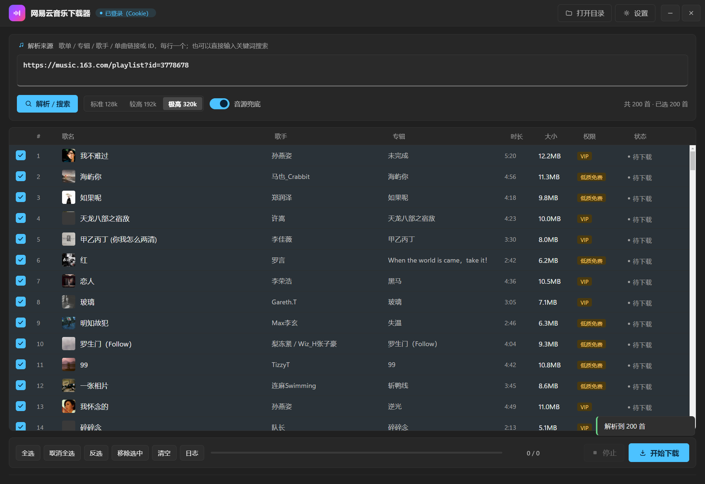
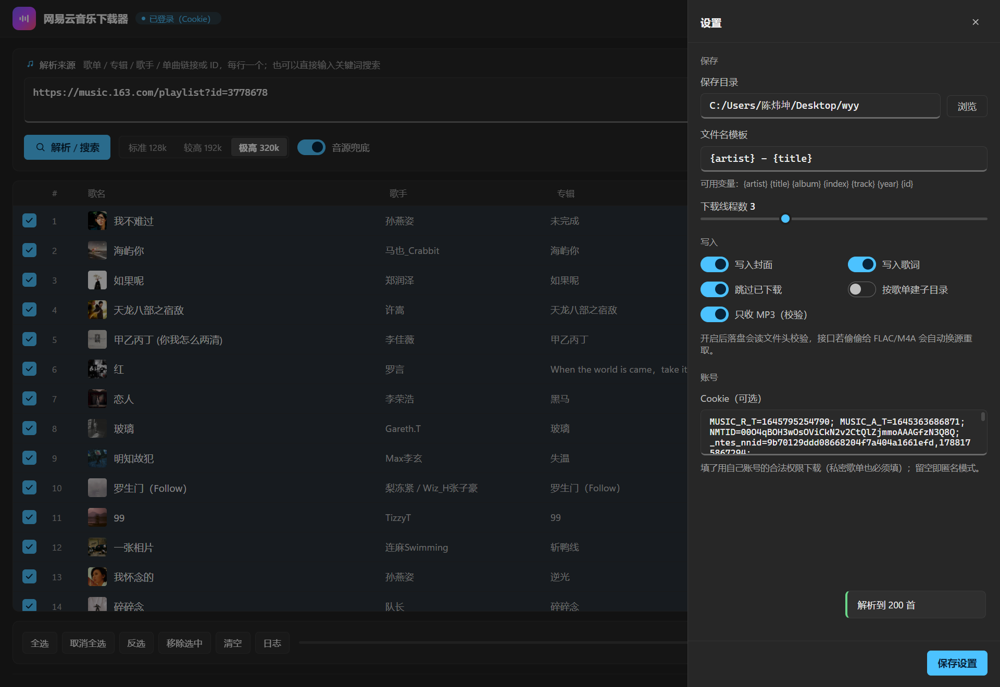
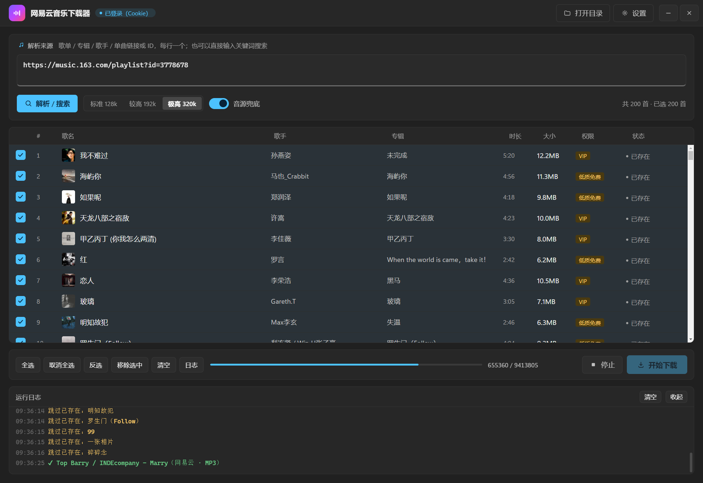

# 网易云音乐下载器 v2.1（Windows 桌面版）

免会员下载网易云音乐的 MP3/FLAC：支持**单曲、歌单、专辑、歌手全部作品、关键词搜索批量下载**，
下载后自动写入**标题 / 歌手 / 专辑 / 封面 / 歌词 / 音轨号**，任何播放器（foobar2000、手机、车机、
Windows 媒体播放器）都能直接显示正确信息。

界面是 **WebView2 渲染的无边框现代 UI**（窗口里没有任何系统标题栏、也没有浏览器自带的工具栏）：
自绘顶栏（拖动 / 双击最大化 / 自绘最小化与关闭）、深色玻璃卡片、封面缩略图、逐曲状态胶囊、
抽屉式设置、可收起日志面板。



| 设置抽屉 | 运行日志 |
|---|---|
|  |  |

## 直接使用

双击 `dist\网易云音乐下载器.exe` 即可，**免安装**（单文件 17MB，界面用系统自带的 Edge 内核，不用装运行库）。

1. 在输入框粘贴链接或 ID，每行一个，例如：
   - 歌单：`https://music.163.com/playlist?id=3778678`
   - 专辑：`https://music.163.com/album?id=32311`
   - 单曲：`https://music.163.com/song?id=287398`
   - 歌手：`https://music.163.com/artist?id=6452`（抓该歌手全部歌曲）
   - 也可以直接输入关键词搜索，如 `周杰伦 稻香`
2. 选音质（标准 128k / 较高 192k / 极高 320k / 无损 FLAC / Hi-Res），点「解析 / 搜索」。
3. 列表里点最左边的 `☑` 勾选（默认全选），点「开始下载」。
4. 文件默认保存到设置里的目录（可在「设置 → 保存目录」改）。

窗口操作：拖动顶栏移动窗口，双击顶栏最大化/还原，右上角 `—` 最小化、`✕` 关闭（关窗即退出进程）；
窗口四边可拖拽缩放。**系统标题栏已彻底去掉**——既没有 Windows 原生那条白条，也没有浏览器自绘的工具栏。

## 功能

- **批量 / 歌单下载**：解析后整列表勾选下载，多线程（默认 3–4，1–8 可调）、失败自动重试、
  已存在同尺寸文件自动跳过。
- **原版音频**：优先取网易云官方直链；无损档位取 FLAC，标签按 FLAC Vorbis Comment 写入。
- **完整标签**：ID3v2.4 + APIC 封面（1200×1200）+ USLT 内嵌歌词 + 专辑/歌手/音轨号。
- **音源兜底**（默认开启）：网易云因版权/付费只给 30 秒试听时，自动去酷我音乐找同一首歌的完整音频
  （歌名+歌手+时长三重匹配，多候选逐一校验实际时长），标签仍用网易云数据写。
- **界面**：封面缩略图、权限徽章（VIP / 低质免费 / 付费专辑）、逐曲状态胶囊、实时进度与速度、
  Toast 提示；双击某行在浏览器打开该曲的网易云页面。

## 关于「不用会员」与账号

匿名接口能拿到的部分（约七成曲目，含大量 320k 与部分无损）直接就是完整原版。剩下的收费曲目：
网易云只回 30 秒试听 → 自动换酷我；酷我也只给试听 → 明确报「各平台均为付费曲」，不会偷偷塞 30 秒文件。

**这软件不需要任何 API key。** 想用自己的账号权限（私密歌单、VIP/付费曲、Hi-Res）时，填 **Cookie**：

1. 浏览器登录 `https://music.163.com`；
2. `F12` → Network → 随便点一条 `api` 请求 → 看 Request Headers 里的 `Cookie`；
3. 复制其中 `MUSIC_U=xxxx`（连同 `__csrf=xxxx` 一起复制更稳），粘进「设置 → Cookie」，保存。

> 网易云私有歌单（链接带 `uct2=` 的那种）匿名接口读不到，会提示「私密歌单需要登录 Cookie」。

## 关于 `.part` 文件

下载中的文件先写成 `歌名 - 歌手.mp3.part`，**下完才改名成正式文件**（避免半截文件被播放器误读）。
正常完成或失败都会自动清掉；只有程序被强杀（任务管理器结束进程 / 断电）才会残留，
直接删掉即可，不影响使用。

## 技术架构

界面不是 Tkinter，也不是浏览器套壳窗口，而是 **本地 HTTP 服务 + pywebview(WebView2) 无边框窗口**：

- 用 `pywebview` 直接开一个 `frameless=True` 的 WebView2 窗口，页面自绘整个界面；
- **为什么不用 `msedge --app`**：那个方案里只要把系统标题栏剥掉，Chromium 就会在客户区里
  自己画一条 28px 的工具栏（WebAppFrameToolbar，带最小化/最大化/关闭），试遍了
  `--disable-features=WebAppFrameToolbar / WindowsCustomTitleBar / CustomFrameView …` 都关不掉
  （实测客户区高度 - innerHeight 恒为 28）；换成 pywebview 后这个差值直接变成 0；
- 窗口拖动交给 pywebview 的 `easy_drag`，并把拖动区域限制在顶栏
  （`DRAG_REGION_SELECTOR` + `DRAG_REGION_DIRECT_TARGET_ONLY`），否则输入框里拖选文字也会拽窗口；
- 缩放边框由 `shell.py` 给窗口补 `WS_THICKFRAME`；最大化/还原是自己算矩形
  （`SystemParametersInfo(SPI_GETWORKAREA)` + `SetWindowPos`），来回切不漂移；
- 最小化 / 关闭走 pywebview 的窗口对象（`minimize()` / `destroy()`），
  后端 `Backend.win()` 通过 `server.WIN_HANDLER` 调到；
- 关掉窗口 → `webview.start()` 返回 → 进程退出，不留后台；
- 兜底：万一 pywebview 起不来（缺 WebView2 运行库等），自动退回 `msedge --app` 方案。

前端 `ncm/web/` 是纯静态页面（HTML/CSS/JS，无框架、无 CDN），通过 `POST /api/<方法>` 调后端，
后端用 `text/event-stream` 把进度事件推回页面。

| 文件 | 作用 |
|---|---|
| `ncm/api.py` | 网易云 eapi/weapi 封装：搜索、歌单、专辑、歌手、直链、歌词（含签名、限速、退避重试） |
| `ncm/core.py` | 下载引擎：线程池、试听检测、兜底换源、进度事件 |
| `ncm/fallback.py` | 酷我音源：搜索、候选排序（歌名/歌手/时长打分）、直链提取 |
| `ncm/tagger.py` | MP3(ID3) / FLAC 标签与封面写入 |
| `ncm/server.py` | 本地 HTTP + SSE 后端（`Backend` 类里是全部业务动作） |
| `ncm/shell.py` | 桌面外壳：pywebview 无边框窗口、拖动区域、缩放边框、最大化/还原、关窗退出（含 Edge 退路） |
| `ncm/web/` | 前端页面（index.html / style.css / app.js / favicon.ico） |
| `ncm/ui.py` | 旧版 Tkinter 界面（`python main.py --tk` 可切回，留作备用） |

## 开发

```
python main.py                 # 源码运行（现代界面）
python main.py --tk            # 旧 Tkinter 界面
python selftest.py             # 下载引擎端到端自检（含标签校验）
python tools/gen_icon.py       # 组装图标（先跑 tools/gen_icon.ps1 渲染位图）
python tools/drive_shot.py     # 用 DevTools 协议驱动界面并截图到 shots/
python tools/probe_frame.py    # 诊断：无边框窗口里有没有浏览器自绘的工具栏
python tools/probe_flags.py    # 批量试 Chromium 特性开关，找能关掉工具栏的那个
```

打包：

```
python -m PyInstaller --noconfirm --onefile --windowed --name "网易云音乐下载器" \
  --icon "build/ncm.ico" --add-data "ncm/web;ncm/web" --collect-submodules ncm \
  --hidden-import mutagen --hidden-import requests main.py
```

仅用于个人合法获取可公开试听的音乐，请勿用于传播或商业用途。


---

## v3.0 · Electron 内核版（当前主推）

外壳换成 **Electron 33（Chromium 130）**，界面仍是 WinUI 深色风，功能与 v2.x 完全一致。

### 架构

```
dist-electron/网易云音乐下载器-win32-x64/
├── 网易云音乐下载器.exe      ← Electron 主进程（窗口 / 原生动画 / IPC）
├── resources/app/            ← main.js · preload.js · 渲染层(HTML+CSS+JS)
└── resources/ncm_backend.exe ← sidecar：原 Python 引擎（解析 / 下载 / 打标签）
```

- Electron 负责：无边框窗口、`-webkit-app-region` 拖动、`setOpacity` 淡出关闭、最小化、
  外链走系统浏览器、单实例。
- sidecar 负责：全部业务逻辑（eapi 签名、音源兜底、MP3 校验、ID3/封面/歌词、断点续传）。
  Electron 启动时传入随机 token，后端只监听 `127.0.0.1` 随机端口，渲染层通过本地 HTTP 调用。
- 父进程退出 → 子进程 2 秒内自杀（`NCM_PARENT_PID` 看门狗），不留野进程。

### 开发 / 打包

```bash
cd electron
npm install                       # ELECTRON_MIRROR=https://npmmirror.com/mirrors/electron/
npm start                         # 开发运行（需先有 ../dist/ncm_backend.exe）
```

```bash
# 1) 重新构建 sidecar
python -m PyInstaller --onefile --console --name ncm_backend   --add-data "<项目>/ncm/web;ncm/web" --collect-submodules ncm   electron/backend_main.py
# 2) 打 Electron 包
cd electron && npx electron-packager . "网易云音乐下载器" --platform=win32 --arch=x64   --out=../dist-electron --overwrite --icon=build/ncm.ico   --extra-resource=../dist/ncm_backend.exe
```

### 与之前几个版本的关系

| 版本 | 外壳 | 状态 |
|---|---|---|
| v1.0 | Tkinter | 保留 `python main.py --tk` |
| v2.x | WebView2（`msedge --app` / pywebview） | 保留 `python main.py` |
| v3.0 | **Electron** | **当前主推**，`dist-electron/` |

## 关于这个仓库

本仓库原名 `163download`，最早由一句「网易云音乐下载器 Windows」的占位 README 建立，现在存放 v2.1 / v3.0 的完整源码。
