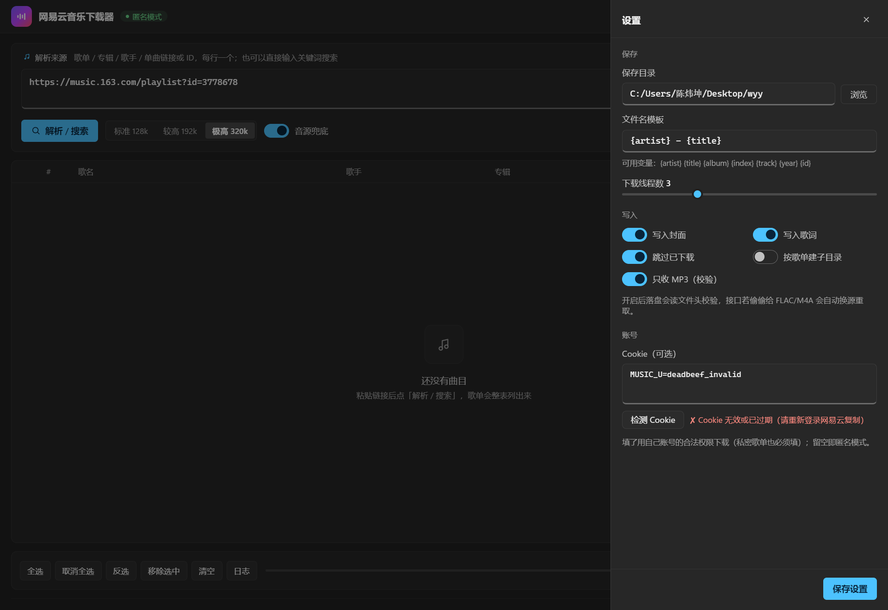
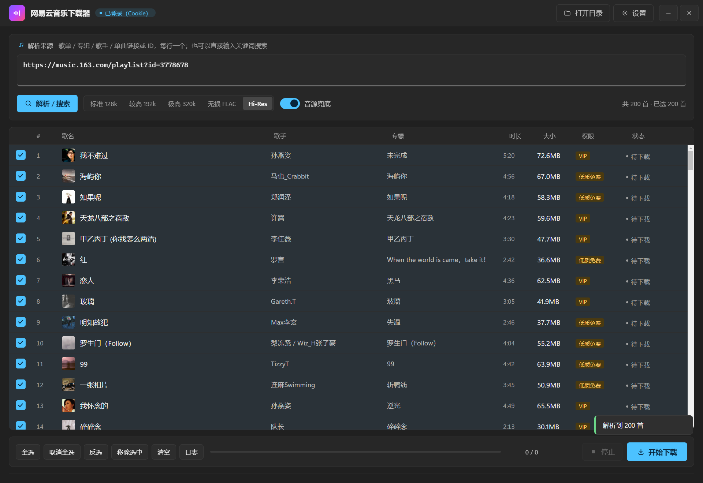

# 网易云音乐下载器 · Windows 桌面版

免会员下载网易云音乐：支持**单曲 / 歌单 / 专辑 / 歌手全部作品 / 关键词搜索**批量下载，
自动写入**标题 · 歌手 · 专辑 · 封面 · 歌词 · 音轨号**，任何播放器（foobar2000、手机、车机、
Windows 媒体播放器）都能显示正确信息。

外壳是 **Electron 33（Chromium 130）**，界面为自绘 WinUI 深色风——没有系统标题栏、没有浏览器工具栏；
关窗是「淡出 + 轻微缩小」的原生手感动画，最小化走系统动画。


| 设置抽屉 | 运行日志 |
|---|---|
|  |  |

---

## 一、直接用（成品）

成品在**同级目录**，双击 `网易云音乐下载器.exe` 即可，免安装。

> 📌 成品目录：`C:\Users\陈炜坤\网易云下载器-可运行`（桌面上有个指向它的快捷方式）。
> 快捷方式失效说明成品被移动过，重新指一下「目标」即可。

1. 输入框粘链接或 ID，每行一个：
   - 歌单 `https://music.163.com/playlist?id=3778678`
   - 专辑 `https://music.163.com/album?id=32311`
   - 单曲 `https://music.163.com/song?id=287398`
   - 歌手 `https://music.163.com/artist?id=6452`（抓该歌手全部作品）
   - 也可以直接输入关键词搜索，如 `周杰伦 稻香`
2. 选音质：**标准 128k / 较高 192k / 极高 320k / 无损 FLAC / Hi-Res**，点「解析 / 搜索」。
3. 列表默认全选，点「开始下载」。底部进度条按**歌曲首数**推进（`已下载 21 / 200 首`），
   右侧显示实时速度；鼠标悬停进度条可看「失败 / 跳过 / 剩余」明细。
4. 文件默认保存到「设置 → 保存目录」，可改。

窗口操作：拖顶栏移动、双击顶栏最大化、`—` 最小化、`✕` 关闭（关窗即退出，不留后台进程）；
四边可拖拽缩放。

## 二、功能清单

- **批量 / 歌单下载**：整列表勾选下载，1–8 线程可调（默认 3）、失败重试、同尺寸文件自动跳过。
- **音质档位**：五档可选；列表的「大小」列按所选档位预估体积，下载后按真实文件头校验
  （「只收 MP3」开关默认开启，接口若偷给 FLAC/M4A 会自动换源重取）。
- **原版音频**：优先网易云官方直链；无损档取 FLAC（Vorbis Comment 写标签）。
- **完整标签**：ID3v2.4 + APIC 封面（1200×1200）+ USLT 内嵌歌词 + 专辑 / 歌手 / 音轨号。
- **音源兜底**（默认开启）：网易云因版权或付费只回 30 秒试听时，自动去酷我音乐找同一首的完整音频
  （歌名 + 歌手 + 时长三重匹配，多候选逐一校验实际时长），标签仍用网易云数据写。
- **Cookie 检测**：填完 Cookie 点「检测 Cookie」，立刻返回**有效 / 已过期 / 格式不对**，
  顶部状态胶囊同步显示「已登录（Cookie）」或「匿名模式」。
- **界面**：封面缩略图、权限徽章（VIP / 低质免费 / 付费专辑）、逐曲状态胶囊
  （待下载 / 下载中 / 完成 7.1MB / 已存在）、Toast 提示；双击某行在浏览器打开该曲页面。

| Cookie 校验提示 | 无损 / Hi-Res 档位 |
|---|---|
|  |  |

## 三、关于「不用会员」与账号

匿名接口能拿到的部分（约七成曲目，含大量 320k 与部分无损）本身就是完整原版。剩下的收费曲目：
网易云只回 30 秒试听 → 自动换酷我；酷我也只有试听 → 明确报「各平台均为付费曲」，不会偷偷塞个 30 秒文件。

**这软件不需要任何 API key。** 想用自己账号的权限（私密歌单、VIP / 付费曲、Hi-Res）时填 **Cookie**：

1. 浏览器登录 `https://music.163.com`；
2. `F12` → Network → 随便点一条 `api` 请求 → Request Headers 里的 `Cookie`；
3. 复制 `MUSIC_U=xxxx`（连 `__csrf=xxxx` 一起更稳），粘进「设置 → Cookie」，点「检测 Cookie」确认再保存。

> 私有歌单（链接带 `uct2=` 的）匿名接口读不到，会提示「私密歌单需要登录 Cookie」。

## 四、关于 `.part` 文件

下载中的文件先写成 `歌名 - 歌手.mp3.part`，**下完才改名**（避免半截文件被播放器误读）。
正常完成或失败都会自动清理；只有程序被强杀（任务管理器结束进程 / 断电）才会残留，删掉即可。

---

## 五、技术架构

```
成品目录（网易云下载器-可运行）
├── 网易云音乐下载器.exe       ← Electron 主进程：窗口 / 关闭动画 / IPC / 单实例
└── resources/
    ├── app/                   ← main.js · preload.js · 渲染层（HTML+CSS+JS，无框架无 CDN）
    └── ncm_backend.exe        ← sidecar：Python 引擎（解析 / 下载 / 打标签）
```

- **Electron** 只做壳：无边框窗口、`-webkit-app-region: drag` 拖动、四边缩放、最小化、
  关窗时 150ms 淡出 + 缩到 95.5%（`setOpacity` + `setBounds`，中心不动）、外链走系统浏览器、单实例。
- **sidecar** 做全部业务：eapi/weapi 签名、音源兜底、MP3 文件头校验、ID3/FLAC 标签、断点续传。
  Electron 启动时生成随机 token 经 `NCM_TOKEN` 传入，后端只监听 `127.0.0.1` 随机端口；
  渲染层用 `POST /api/<方法>` 调用，进度走 `text/event-stream`。
- 父进程退出 → 子进程 2 秒内自杀（`NCM_PARENT_PID` 看门狗），不留野进程。

> 为什么壳必须自己画动画：WebView2 / Electron 的页面画在子窗口里，对父窗口做 `WS_EX_LAYERED`、
> `AnimateWindow` 都影响不到子窗口像素，所以关闭过渡只能由壳进程对窗口本身做。

### 源码结构（本目录 `163download`）

| 路径 | 作用 |
|---|---|
| `electron/main.js` | 主进程：窗口创建、关闭动画、最小化、sidecar 拉起与看门狗 |
| `electron/preload.js` | 渲染层 ↔ 主进程桥（`window.ncmWin.*`） |
| `electron/backend_main.py` | 后端入口：打印端口 JSON 给主进程 |
| `ncm/api.py` | 网易云 eapi/weapi：搜索、歌单、专辑、歌手、直链、歌词（签名 / 限速 / 退避重试） |
| `ncm/core.py` | 下载引擎：线程池、试听检测、兜底换源、`sniff_audio` 文件头校验、进度事件 |
| `ncm/fallback.py` | 酷我音源：搜索、候选打分、直链提取 |
| `ncm/tagger.py` | MP3(ID3v2.4) / FLAC 标签与封面写入 |
| `ncm/server.py` | 本地 HTTP + SSE 后端（`Backend` 类里是全部业务动作，含 `check_cookie`） |
| `ncm/web/` | 渲染层页面（index.html / style.css / app.js / favicon.ico） |
| `main.py` · `ncm/shell.py` | v2.1 WebView2 版入口，备用 |
| `main_qt.py` · `ncm/qtui.py` | v2.2 Qt/PySide6 版入口，备用 |
| `ncm/ui.py` | v1.0 Tkinter 界面（`python main.py --tk`） |
| `tools/` | CDP 驱动与验证脚本（截图 / 进度 / Cookie / 关闭动画探针） |
| `assets/ncm.ico` · `build/ncm.ico` | 应用图标 |
| `screenshots/` | 界面截图 |

## 六、开发与打包

```bash
# 1) 源码跑 Electron（需先有 sidecar）
cd electron && npm install        # 镜像：ELECTRON_MIRROR=https://npmmirror.com/mirrors/electron/
npm start

# 2) 重新构建 sidecar（改了 Python 就做这步，并替换成品里的 resources/ncm_backend.exe）
python -m PyInstaller --noconfirm --onefile --console --name ncm_backend \
  --add-data "<本目录>/ncm/web;ncm/web" --collect-submodules ncm \
  --hidden-import mutagen --hidden-import requests electron/backend_main.py

# 3) 打 Electron 包
cd electron && npx electron-packager . "网易云音乐下载器" --platform=win32 --arch=x64 \
  --out=../dist-electron --overwrite --icon=build/ncm.ico --extra-resource=../dist/ncm_backend.exe
```

验证脚本（都走 CDP，启动 app 时给环境变量 `NCM_DEBUG_PORT`）：

```bash
python tools/check_cookie_ui.py      # Cookie 检测交互 + 截图
python tools/check_progress_lite.py  # 下载进度是否按首数推进
python tools/probe_el_close.py       # 关闭动画逐帧采样
python tools/drive_electron.py       # 解析 → 下载 → 截图
```

### 版本对照

| 版本 | 外壳 | 状态 |
|---|---|---|
| v1.0 | Tkinter | 备用（`python main.py --tk`） |
| v2.1 | WebView2（`msedge --app` / pywebview） | 备用（`python main.py`） |
| v2.2 | Qt / PySide6 | 备用（`python main_qt.py`） |
| **v3.0** | **Electron 33** | **当前定版** |

> 本目录原名 `网易云下载器-源码`，2026-10 定版后改名为 `163download`。

---

仅用于个人合法获取可公开试听的音乐，请勿用于传播或商业用途。
